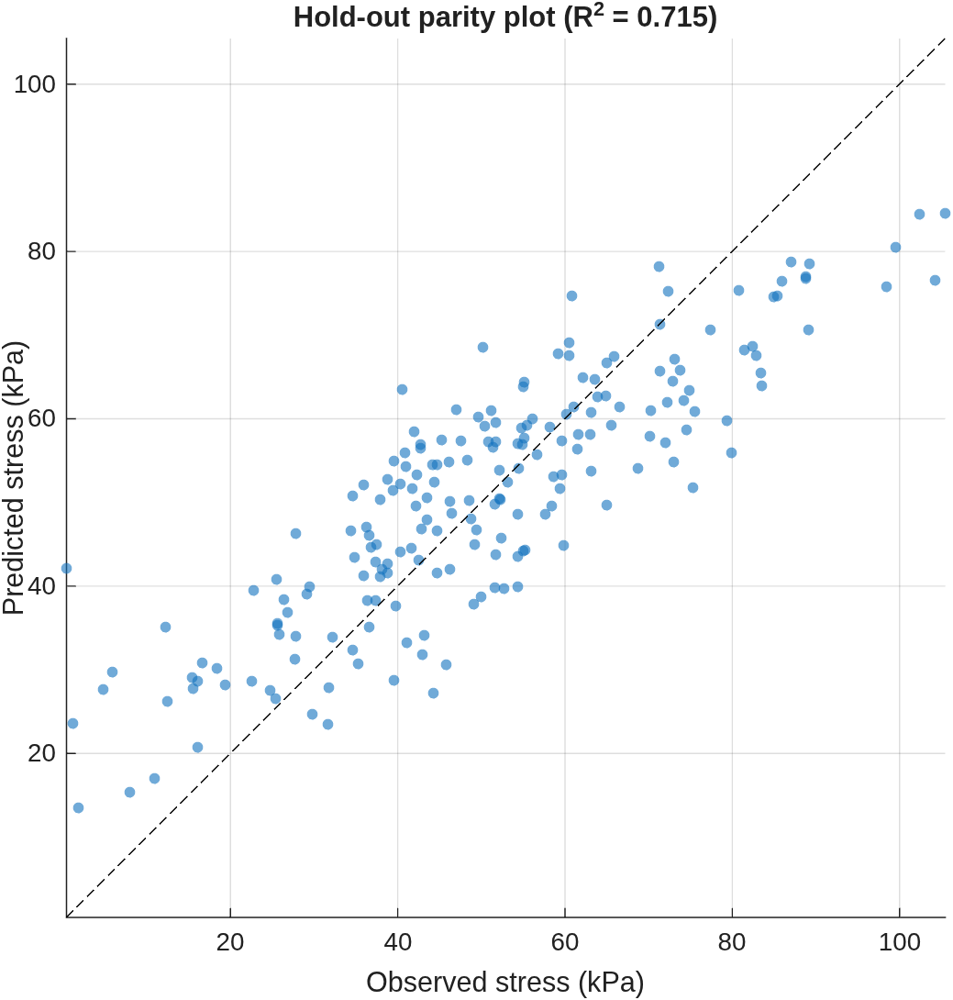
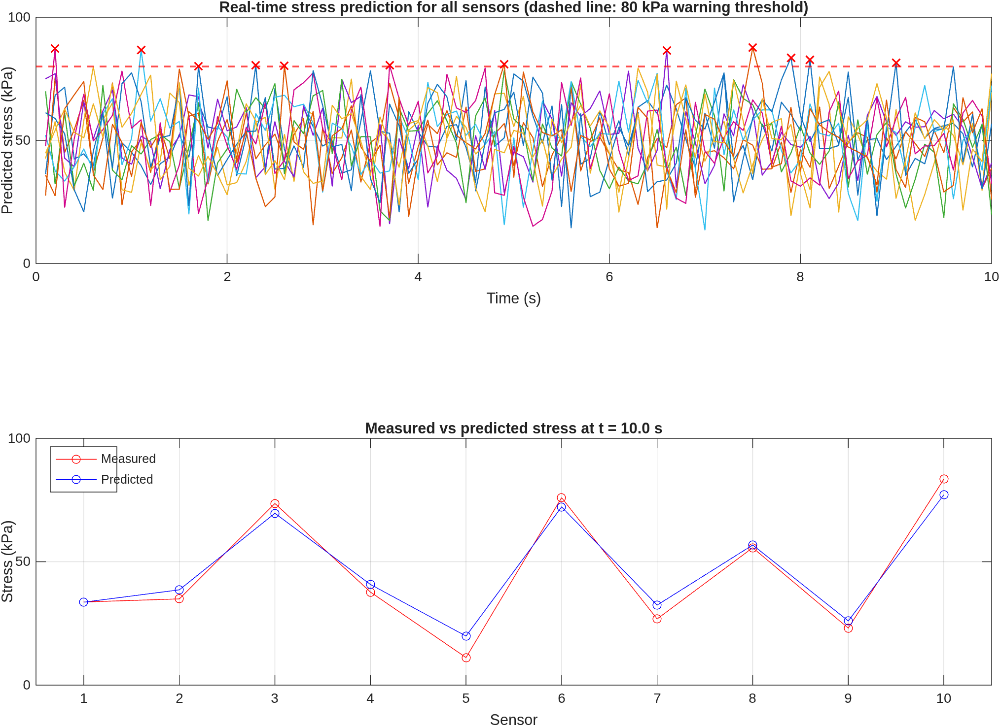

# 01 · Digital twin for bridge stress monitoring

Book section 15.6.2.

A virtual replica of a bridge instrumented with ten sensors. A bagged ensemble of 300 regression trees (`fitrensemble`, minimum leaf size 5) is trained on historical data to predict stress from three sensor features. The trained model is then applied to a 10 s stream sampled at 10 Hz, and a warning is logged whenever predicted stress exceeds 80 kPa.

## Model

- Mean squared error: $\mathrm{MSE} = \frac{1}{n}\sum_{i=1}^{n}(y_i-\hat{y}_i)^2$
- Mean absolute error: $\mathrm{MAE} = \frac{1}{n}\sum_{i=1}^{n}\lvert y_i-\hat{y}_i\rvert$
- Coefficient of determination: $R^2 = 1-\dfrac{\sum_{i}(y_i-\hat{y}_i)^2}{\sum_{i}(y_i-\bar{y})^2}$
- Warning rule: $\hat{y}_i > 80\ \text{kPa}$

The data are synthetic. The target is the mean of the three features plus Gaussian noise with standard deviation 10 kPa, so the attainable $R^2$ is bounded at roughly 0.74 by the noise level. Values close to that bound indicate that the model has captured the signal.

## Results

From the automated run in GitHub Actions (seed 42):

| Metric | Value |
|---|---:|
| Hold-out MSE | 125.36 kPa² |
| Hold-out MAE | 9.23 kPa |
| Hold-out $R^2$ | 0.715 |
| Warnings raised on the 10 s stream | 12 |
| MAE between predicted and measured stress on the stream | 2.81 kPa |

The hold-out $R^2$ of 0.715 is close to the noise-limited bound of about 0.74.

## Outputs

- `results/parity_plot.png`: observed vs predicted stress on the hold-out set
- `results/digital_twin_monitoring.png`: predicted stress over time for all sensors with the warning threshold, and measured vs predicted stress at the final time step
- `results/warnings.csv`: time, sensor and predicted stress for every warning

## Changes relative to the printed version

- Random seed fixed for reproducibility.
- Hold-out split drawn at random with `cvpartition` instead of taking the first 80% of rows.
- The monitoring loop no longer depends on wall-clock time (`tic`/`toc`), so every run processes all 100 samples. Animation is optional through `liveMode`.
- All sensors are predicted at every time step and warnings are stored in a table rather than only printed.
- The MAE definition above uses the absolute error; the printed equation shows a squared term.
