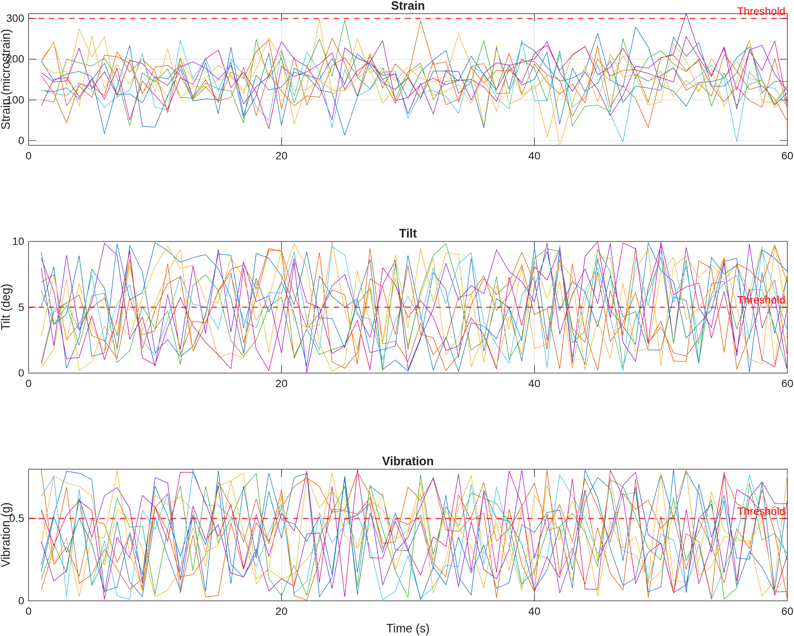
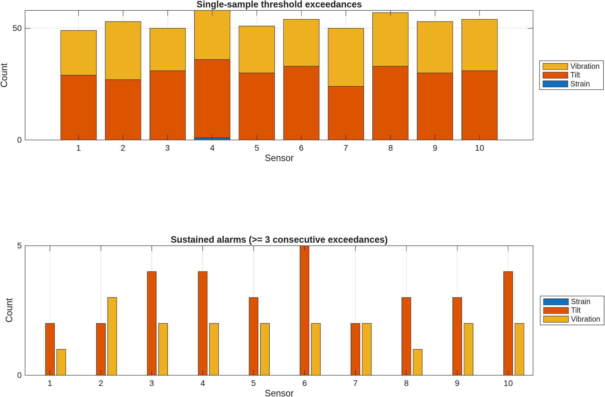

# 03 · IoT structural monitoring of a bridge

Book section 15.6.3.

Simulated streams from ten IoT sensors measuring strain, tilt and vibration over 60 s. Each reading is compared with a threshold, and the number of exceedances is counted per sensor and parameter.

## Model

- Strain: $\varepsilon_i(t) \sim \mathcal{N}(150, 50^2)$ microstrain, threshold 300
- Tilt: $\theta_i(t) \sim \mathcal{U}(0, 10)$ degrees, threshold 5
- Vibration: $v_i(t) \sim \mathcal{U}(0, 0.8)$ g, threshold 0.5
- Warning count per sensor: $W_i = \sum_{t=1}^{N} \mathbb{1}\left[x_i(t) > x_{\text{threshold}}\right]$

In addition to single-sample warnings, the script counts **sustained alarms**: runs of at least three consecutive exceedances. Single-sample rules flag isolated spikes caused by noise, while persistence-based rules are the usual way to reduce false alarms in structural health monitoring.

The thresholds and distributions are illustrative. With uniform tilt on 0–10° and a 5° threshold, about half of all tilt readings exceed the limit, which is why tilt dominates the warning counts.

## Results

From the automated run in GitHub Actions (seed 42), over 10 sensors and 60 s:

| Rule | Count |
|---|---:|
| Single-sample warnings | 529 |
| Sustained alarms (at least 3 consecutive exceedances) | 51 |

The persistence rule reduces the number of alerts by roughly a factor of ten. Strain exceeded its threshold only once, at sensor 4, and never for three consecutive samples.

## Outputs

- `results/sensor_streams.png`: strain, tilt and vibration histories for all sensors with thresholds
- `results/warnings_and_alarms.png`: single-sample warnings (stacked) and sustained alarms (grouped) per sensor
- `results/warning_summary.csv`: counts per sensor

## Changes relative to the printed version

- Exceedance detection is vectorised; the real-time animation is optional through `liveMode`, so the script runs in seconds by default.
- Sustained-alarm detection added.
- Full time histories are plotted with threshold lines.
- Random seed fixed for reproducibility.
