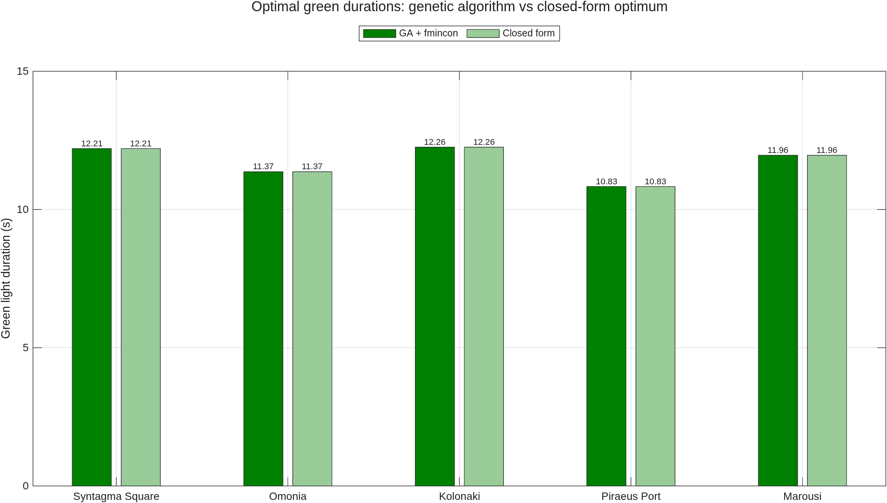

# 04 · Traffic signal optimisation in Athens

Book section 15.6.3.

Green-light durations at five Athens locations (Syntagma Square, Omonia, Kolonaki, Piraeus Port, Marousi) are optimised with a genetic algorithm. The traffic data are read from [`data/athens_traffic.csv`](data/athens_traffic.csv), which can be replaced by any file with the same columns.

## Model

The fitness function used in the code is

$$
f(\mathbf{g}) = \sum_{i=1}^{n} \frac{g_i \, o_i}{s_i + 1} + \sum_{i=1}^{n} \frac{q_i}{g_i + 1}, \qquad 10 \le g_i \le 120
$$

where $g_i$ is the green duration (s), $o_i$ occupancy, $s_i$ speed and $q_i$ flow at location $i$. The first term penalises green time weighted by occupancy relative to speed; the second penalises short greens relative to flow.

## Verification

The function is separable and convex in each $g_i$, so its global optimum has a closed form:

$$
g_i^{*} = \sqrt{\frac{q_i\,(s_i+1)}{o_i}} - 1
$$

clipped to the bounds. The script solves the problem with `ga` (followed by an `fmincon` refinement) and compares the result with $g_i^{*}$. The GA reproduces the closed-form optimum, which confirms the solver configuration and gives a reference for extending the model to non-separable formulations, such as coordinated corridors, where no closed form exists.

| Location | $g^{*}$ (s) |
|----------|------------:|
| Syntagma Square | 12.21 |
| Omonia | 11.37 |
| Kolonaki | 12.26 |
| Piraeus Port | 10.83 |
| Marousi | 11.96 |

These values agree with the GA results printed in the book to within 0.01 s.

## Results

From the automated run in GitHub Actions (seed 42), the GA with `fmincon` refinement reaches the closed-form optimum to within $1.85 \times 10^{-6}$ s at every location, with identical fitness (335.778073).

## Outputs

- `results/green_durations.png`: GA and closed-form durations per location
- `results/green_durations.csv`: durations and absolute differences

## Changes relative to the printed version

- Traffic data read from a CSV file. The printed script calls `xmlread` on a file that is not supplied and then uses hard-coded values, so it fails unless that file exists.
- Closed-form optimum computed and compared with the GA solution.
- `HybridFcn` set to `fmincon` for a precise final solution.
- The printed fitness equation shows only the first term without the $+1$; the formula above matches the code that produced the book's results.
- Random seed fixed for reproducibility.
