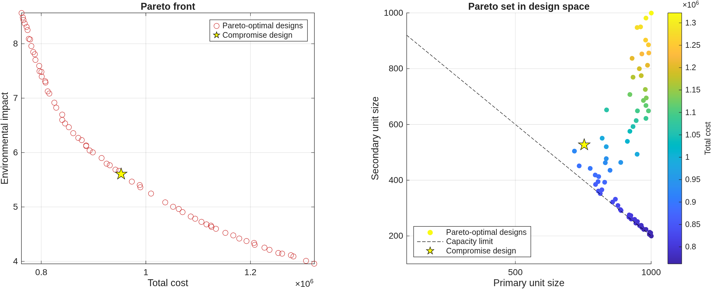

# 05 · Multi-objective design of a wastewater treatment plant

Book section 15.4.6.

The sizes of the primary ($x_1$) and secondary ($x_2$) treatment units are chosen to minimise total cost and environmental impact simultaneously, subject to a minimum treatment capacity. `gamultiobj` returns a set of Pareto-optimal designs, and the script selects a compromise design from that set.

## Model

$$
C(x_1,x_2) = 7000\,x_1^{0.6} + 9000\,x_2^{0.65} + 100\,x_1^{0.8} + 150\,x_2^{0.85}
$$

$$
I(x_1,x_2) = 250\,x_1^{-0.7} + 350\,x_2^{-0.75}
$$

$$
\min_{x_1,x_2}\ \bigl(C,\ I\bigr) \quad \text{s.t.} \quad 1.2\,x_1 + 1.5\,x_2 \ge 1500, \qquad 100 \le x_1, x_2 \le 1000
$$

Larger units cost more but reduce environmental impact, so the two objectives conflict and no single design minimises both.

## Compromise selection

Both objectives are normalised to $[0,1]$ over the Pareto front, and the design with the smallest Euclidean distance to the utopia point $(0,0)$ is reported as the compromise. This is one common rule; weighted or knee-point criteria can be substituted.

## Results

From the automated run in GitHub Actions (seed 42):

| Quantity | Value |
|---|---:|
| Pareto-optimal designs | 70 |
| Primary unit range | 718 to 1000 |
| Secondary unit range | 200 to 1000 |
| Compromise design $(x_1, x_2)$ | (754, 527) |
| Compromise total cost | $9.53 \times 10^5$ |
| Compromise environmental impact | 5.60 |

Designs at the low-cost end of the front lie on the capacity limit, as expected when cost increases with unit size.

## Outputs

- `results/pareto_front.png`: Pareto front in objective space, and the Pareto set in design space with the capacity constraint
- `results/pareto_front.csv`: all Pareto-optimal designs sorted by cost

## Changes relative to the printed version

- The capacity constraint is linear and is passed as a linear inequality instead of a nonlinear constraint function. The feasible set is unchanged and the solver handles it more efficiently.
- Results sorted by cost, with the capacity margin checked.
- Compromise design selection added.
- The `PlotFcn` live plots are removed so the script runs without interaction; final plots are exported.
- Random seed fixed for reproducibility.
