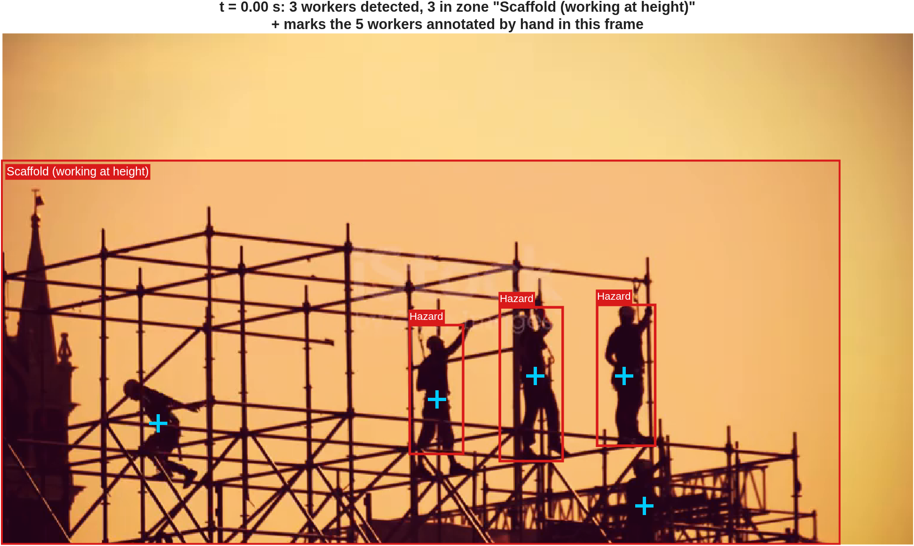
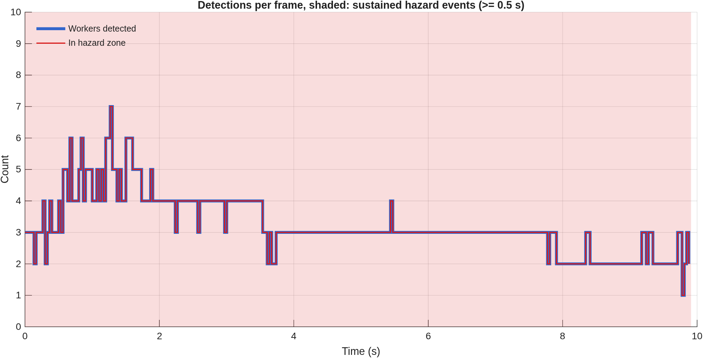

# 06 · Worker detection and hazard identification on a construction site

Book section 15.6.5, Fig. 15.17.

Workers are detected frame by frame in a video with MATLAB's pre-trained Aggregate Channel Features (ACF) people detector. Overlapping detections are removed with non-maximum suppression. A worker is labelled **Hazard** when standing inside a designated hazard zone and **Worker** otherwise. Hazard occurrences that last long enough are reported as sustained events.

## Model

- Detection: $`[\mathbf{B}, \mathbf{s}] = \mathrm{detect}(\text{model}, I_t)`$, where each row of $`\mathbf{B}`$ is a box $`(x, y, w, h)`$ and $`\mathbf{s}`$ holds the confidence scores for frame $`I_t`$
- Overlap of two boxes: $`\mathrm{IoU}(A, B) = \dfrac{\lvert A \cap B \rvert}{\lvert A \cup B \rvert}`$; a box is suppressed when its IoU with a stronger box exceeds 0.3
- Foot point of a worker: $`\mathbf{p} = \left(x + \tfrac{w}{2},\; y + h\right)`$
- Hazard label: $`h_j = \mathbf{1}\left[\mathbf{p}_j \in Z\right]`$, where $`Z`$ is the hazard-zone polygon
- Sustained hazard event: a run of at least $`\lceil 0.5\,f \rceil`$ consecutive frames, at frame rate $`f`$, in which $`\sum_j h_j \geq 1`$

The foot point is used instead of the box centre because the hazard depends on where a person stands. A worker on the ground in front of a scaffold may overlap the scaffold in the image without being on it.

## Data

The script processes every case whose video is available. Outputs are prefixed `site_` and `demo_`.

| Case | Video | Detector | Hazard zone |
|---|---|---|---|
| `site` | The construction-site clip used in the book (iStockphoto) | INRIA model (`peopleDetectorACF()`, as in the book) | *Scaffold (working at height)*: the extent of the scaffold, from 25% to 100% of the frame height and up to 92% of its width |
| `demo` | `vippedtracking.mp4`, installed with the Computer Vision Toolbox | Caltech model (`peopleDetectorACF('caltech')`), trained for small, distant pedestrians | *Vehicle path*: the trapezoid ahead of the moving camera |

The construction-site clip is licensed and is **not distributed** with this repository. The GitHub Actions workflow retrieves it from a private repository, converts it to an uncompressed AVI in `data/`, and publishes only the derived figures and tables. The conversion is needed because MATLAB on Linux reads MP4 files only through the system GStreamer codecs, which the GitHub runner does not provide, whereas uncompressed AVI is read natively on every platform. The decoded frames of the AVI are identical, pixel for pixel, to those of the MP4. The `.gitignore` in this folder prevents the video itself from being committed. Readers who hold their own copy of the clip can place it at `data/site-construction-workers.mp4`. Readers without it get the `demo` case, provided the Computer Vision Toolbox sample data is installed; the MATLAB installation used in GitHub Actions does not include that sample data, so the automated run processes the site case only.

In the site clip (768 × 432 pixels, 29.97 fps, 9.9 s) every worker stands on the scaffold, so every correct detection should carry the *Hazard* label, as in Fig. 15.17. The difference from the printed code is that the label now follows from the position of the worker rather than being applied to every detection; a person detected outside the scaffold, or a false detection in the open sky, is labelled *Worker*.

The demo video is filmed from a moving car. Its *Vehicle path* zone corresponds to the exclusion zone around moving plant on a construction site, where struck-by accidents occur. Zone geometry is given in normalised image coordinates and can be adapted to any camera view.

## Results

From the automated run in GitHub Actions on the construction-site clip (Fig. 15.17). Frame-level counts and sustained hazard events are in the CSV files.

## Outputs

- `results/<case>_hazard_frame.png`: an annotated frame with the zone, *Hazard* and *Worker* labels; for the site case this is the first frame, the scene of Fig. 15.17, and for the demo case the frame with the most workers in the zone
- `results/<case>_hazard_timeline.png`: workers detected and workers in the hazard zone per frame, with sustained events shaded
- `results/<case>_detections_per_frame.csv`: time, workers detected and workers in the zone for every frame
- `results/<case>_detections.csv`: every retained detection with its bounding box, ACF score and zone membership
- `results/<case>_hazard_events.csv`: start, end, duration and peak number of workers for each sustained event
- `results/<case>_summary.csv`: summary counts and the distribution of detection scores
- `results/<case>_annotated_video.avi`: the full annotated video, written only when `saveVideo` is set to `true`

## Changes relative to the printed version

- **Hazard zones are now defined and used.** The printed text states that only workers inside designated hazard zones receive the *Hazard* label, but the printed code labels every detected person as *Hazard*. The zones are now explicit polygons, membership is tested on the foot point, and workers outside the zones are labelled *Worker*.
- **Non-maximum suppression is applied once, at the stated threshold.** `detect` already applies `selectStrongestBbox` with its default overlap threshold of 0.5, so the second call with 0.3 in the printed code acted on boxes that had already been suppressed. Built-in suppression is now disabled (`'SelectStrongest', false`) and suppression is applied once with the threshold of 0.3 given in the text.
- The hard-coded MATLAB Drive path is replaced by a path relative to the script. A second case on a MATLAB sample video lets the example run without the licensed clip where that sample data is installed.
- Frame-level statistics and persistence-based hazard events are added, following the alarm logic of [example 03](../03-iot-bridge-monitoring).
- Figures are drawn with standard MATLAB graphics, and the annotated video is optional through `saveVideo`.
- Random seed fixed for consistency with the other examples; the ACF detector itself is deterministic.
