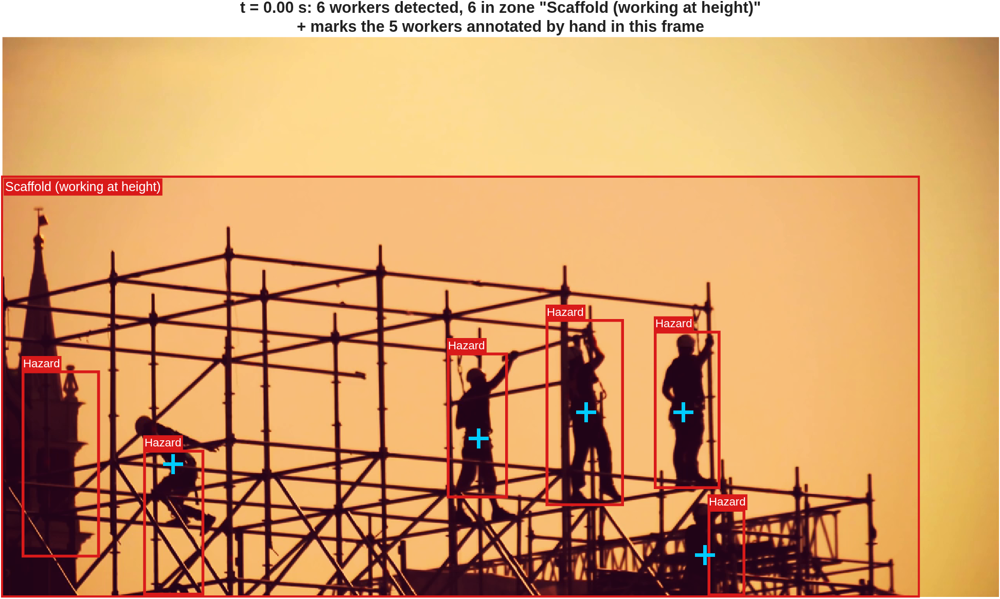
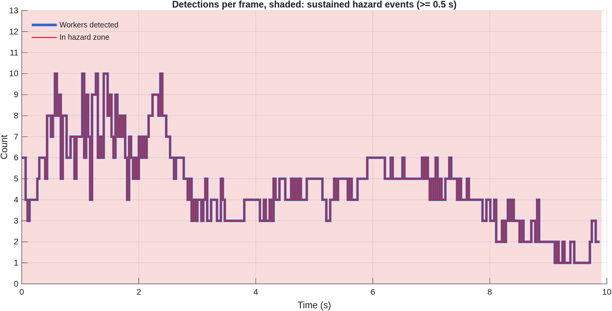

# 06 · Worker detection and hazard identification on a construction site

Book section 15.6.5, Fig. 15.17.

Workers are detected frame by frame in a video with MATLAB's pre-trained Aggregate Channel Features (ACF) people detector. Overlapping detections are removed with non-maximum suppression. A worker is labelled **Hazard** when standing inside a designated hazard zone and **Worker** otherwise. Hazard occurrences that last long enough are reported as sustained events.

## Model

- Detection: $`[\mathbf{B}, \mathbf{s}] = \mathrm{detect}(\text{model}, I_t)`$, where each row of $`\mathbf{B}`$ is a box $`(x, y, w, h)`$ and $`\mathbf{s}`$ holds the confidence scores for frame $`I_t`$
- Overlap of two boxes: $`\mathrm{IoU}(A, B) = \dfrac{\lvert A \cap B \rvert}{\lvert A \cup B \rvert}`$; a box is suppressed when its IoU with a stronger box exceeds 0.3
- Foot point of a worker: $`\mathbf{p} = \left(x + \tfrac{w}{2},\; y + h - 1\right)`$, the centre of the bottom pixel row of the box
- Hazard label: $`h_j = \mathbf{1}\left[\mathbf{p}_j \in Z\right]`$, where $`Z`$ is the hazard-zone polygon
- Sustained hazard event: a run of at least $`\mathrm{round}(0.5\,f)`$ consecutive frames, at frame rate $`f`$, in which $`\sum_j h_j \geq 1`$

The foot point is used instead of the box centre because the hazard depends on where a person stands. A worker on the ground in front of a scaffold may overlap the scaffold in the image without being on it.

## Data

The script processes every case whose video is available. Outputs are prefixed `site_` and `demo_`.

| Case | Video | Detector | Hazard zone |
|---|---|---|---|
| `site` | The construction-site clip used in the book (iStock.com/Filmmaker, stock video 1830893234) | INRIA model (`peopleDetectorACF()`, as in the book) | *Scaffold (working at height)*: the extent of the scaffold, from 25% to 100% of the frame height and up to 92% of its width |
| `demo` | `vippedtracking.mp4`, installed with the Computer Vision Toolbox | Caltech model (`peopleDetectorACF('caltech')`), trained for small, distant pedestrians | *Vehicle path*: the trapezoid ahead of the moving camera |

The construction-site clip is licensed and is **not distributed** with this repository. The GitHub Actions workflow retrieves it from a private repository, converts it to an uncompressed AVI in `data/`, and publishes only the derived figures and tables. The conversion is needed because MATLAB on Linux reads MP4 files only through the system GStreamer codecs, which the GitHub runner does not provide, whereas uncompressed AVI is read natively on every platform. The frames of the AVI are identical, pixel for pixel, to the frames decoded from the MP4 by FFmpeg; this was checked on all 297 frames. The `.gitignore` in this folder prevents the video itself from being committed. Readers who hold their own copy of the clip can place it at `data/site-construction-workers.mp4`; the annotations refer to its 1280 × 720 (HD Web) version. Readers without it get the `demo` case, provided the Computer Vision Toolbox sample data is installed; the MATLAB installation used in GitHub Actions does not include that sample data, so the automated run processes the site case only.

In the site clip (1280 × 720 pixels, 29.97 fps, 9.9 s) every worker stands on the scaffold, so every correct detection should carry the *Hazard* label, as in Fig. 15.17. The difference from the printed code is that the label now follows from the position of the worker rather than being applied to every detection; a person detected outside the scaffold, or a false detection in the open sky, is labelled *Worker*.

The demo video is filmed from a moving car. Its *Vehicle path* zone corresponds to the exclusion zone around moving plant on a construction site, where struck-by accidents occur. Zone geometry is given in normalised image coordinates and can be adapted to any camera view.

## Results

From the automated run in GitHub Actions on the construction-site clip:

| Metric | Value |
|---|---:|
| Frames processed | 297 (9.91 s) |
| Worker detections | 1,383, a mean of 4.7 per frame |
| Frames with a worker in the hazard zone | 297 of 297 |
| Sustained hazard events | 1, spanning the whole clip |
| Detection score, 10th / 50th / 90th percentile | 5.6 / 21.8 / 39.8 |

Because every worker in this clip stands on the scaffold, every detection inside the zone is labelled *Hazard* and the hazard state persists for the whole clip. The zone logic therefore reproduces Fig. 15.17 here; its discriminating effect appears only when people are present both inside and outside a zone. At most five workers are visible in the annotated frames, but the detector reports more than five boxes in 83 frames, 64 of them in the first 2.6 s; the extra boxes are the false detections described under Validation.

The figure shows the first frame of the clip, which is also the first annotated frame, so detections and annotations can be compared directly. Fig. 15.17 in the book shows a later frame of the same clip.

## Validation

The book reports the annotated video without a quantitative check. To measure how reliable the detections are, every visible worker was annotated by hand in 10 frames, one per second (frames 1, 31, …, 271), by marking the centre of the body. The annotations were made on a 768 × 432 copy of the clip and scaled to 1280 × 720 by the factor 5/3, and the scaled points were checked against the frames. They are in [`data/site_ground_truth.csv`](data/site_ground_truth.csv) and the comparison is recomputed on every run.

A detection is a true positive when an annotated centre that has not yet been matched lies inside its box; detections are matched in order of decreasing score, an annotated centre can be matched only once, and when several unmatched centres lie inside one box the one nearest the box centre is matched. Unmatched detections are false positives and unmatched annotations are false negatives:

- Precision: $`P = \dfrac{TP}{TP + FP}`$
- Recall: $`R = \dfrac{TP}{TP + FN}`$

| Annotated frames | Worker instances | TP | FP | FN | Precision | Recall |
|---:|---:|---:|---:|---:|---:|---:|
| 10 | 43 | 36 | 13 | 7 | 0.735 | 0.837 |

Recall depends strongly on how visible the worker is:

| Worker | Instances | Detected | Recall |
|---|---:|---:|---:|
| Standing on the upper deck, in full silhouette against the sky | 30 | 28 | 0.93 |
| Climbing on the left, partly in front of the dark church | 3 | 3 | 1.00 |
| On the lower level, half hidden and against a dark background | 10 | 5 | 0.50 |

The 13 false positives in the annotated frames fall into four groups: 5 are boxes next to the half-hidden worker on the lower level that do not contain his marked centre, 3 lie on the spire or the wall of the church at the left edge, 3 lie on bare scaffolding, and 2 are second boxes on an upper-deck worker who was already matched. A visual check of detections outside the annotated frames points the same way. Of 60 detections drawn at random from the whole clip, 45 clearly contain a worker, 2 are unclear and 13 do not: 9 lie on the lower level next to a worker, 3 on bare scaffolding and 1 on the church. Near the left edge the errors are more frequent: of 30 detections drawn from the 102 whose box centre lies within 192 pixels (15% of the width) of the left edge, 14 clearly contain the climbing worker, 5 are unclear, 5 fall on the church and 6 are oversized boxes (193 × 472 pixels) spanning the left part of the scaffold.

**No score threshold is applied.** The false positives tend to have lower scores than the true detections (median 11.2 against 27.4 in the annotated frames), but the two overlap: a threshold of 14 would remove 9 of the 13 false positives and also 5 of the 36 true detections, and over the whole clip it would remove 51 detections near the left edge, where the climbing worker is, and 336 elsewhere. A threshold chosen on the same clip that is used for evaluation would also overfit it. The detector is therefore used with its default settings, as in the book, and its limitations are reported rather than tuned away.

**Interpretation.** The pre-trained ACF detector of 2014 is reliable for clearly visible, upright workers seen in silhouette against the sky, the situation that dominates this clip. It misses or misplaces workers who are partly occluded or who blend into a dark background, as on the lower level, and it responds to tall, narrow structures such as the church spire and to bare scaffolding. For safety monitoring, where a missed worker matters more than a false alarm, these figures argue for a modern detector trained on construction-site imagery, together with tracking across frames so that a worker missed in one frame is still followed. The validation covers 43 worker instances in a single 10-second clip and should be read as an illustration of the method, not as a general performance estimate.

## Licence of the video

The construction-site clip is iStock.com/Filmmaker, stock video 1830893234, used under an iStock licence. The frame shown in `results/site_hazard_frame.png` is taken from that clip and is not covered by the MIT License of this repository; it may not be extracted or reused on its own. The code, the annotations and the tables are under the MIT License.

## Outputs

- `results/<case>_hazard_frame.png`: an annotated frame with the zone, *Hazard* and *Worker* labels; for the site case this is the first frame, with the hand-annotated workers marked by `+`, and for the demo case the frame with the most workers in the zone
- `results/<case>_hazard_timeline.png`: workers detected and workers in the hazard zone per frame, with sustained events shaded
- `results/<case>_detections_per_frame.csv`: time, workers detected and workers in the zone for every frame
- `results/<case>_detections.csv`: every retained detection with its bounding box, ACF score and zone membership
- `results/<case>_hazard_events.csv`: start, end, duration and peak number of workers for each sustained event
- `results/<case>_summary.csv`: summary counts, the distribution of detection scores and, for the site case, precision and recall
- `results/site_validation.csv`: ground truth, detections, TP, FP and FN for each annotated frame
- `results/<case>_annotated_video.avi`: the full annotated video, written only when `saveVideo` is set to `true`

## Changes relative to the printed version

- **Hazard zones are now defined and used.** The printed text states that only workers inside designated hazard zones receive the *Hazard* label, but the printed code labels every detected person as *Hazard*. The zones are now explicit polygons, membership is tested on the foot point, and workers outside the zones are labelled *Worker*.
- **Non-maximum suppression is applied once, at the stated threshold.** `detect` already applies `selectStrongestBbox` with its default overlap threshold of 0.5, so the second call with 0.3 in the printed code acted on boxes that had already been suppressed. Built-in suppression is now disabled (`'SelectStrongest', false`) and suppression is applied once with the threshold of 0.3 given in the text.
- The hard-coded MATLAB Drive path is replaced by a path relative to the script. A second case on a MATLAB sample video lets the example run without the licensed clip where that sample data is installed.
- Frame-level statistics and persistence-based hazard events are added, following the alarm logic of [example 03](../03-iot-bridge-monitoring).
- A quantitative validation against hand-annotated frames is added; the printed version shows the annotated video only.
- Figures are drawn with standard MATLAB graphics, and the annotated video is optional through `saveVideo`.
- Random seed fixed for consistency with the other examples; the ACF detector itself is deterministic.
